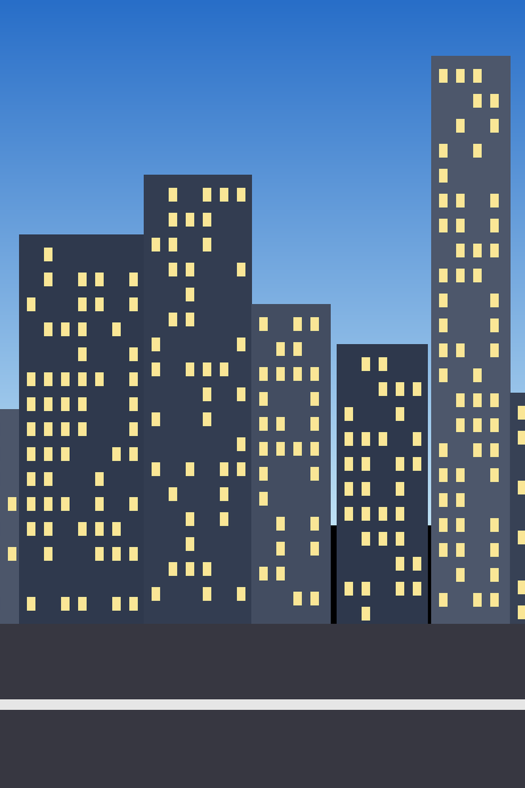
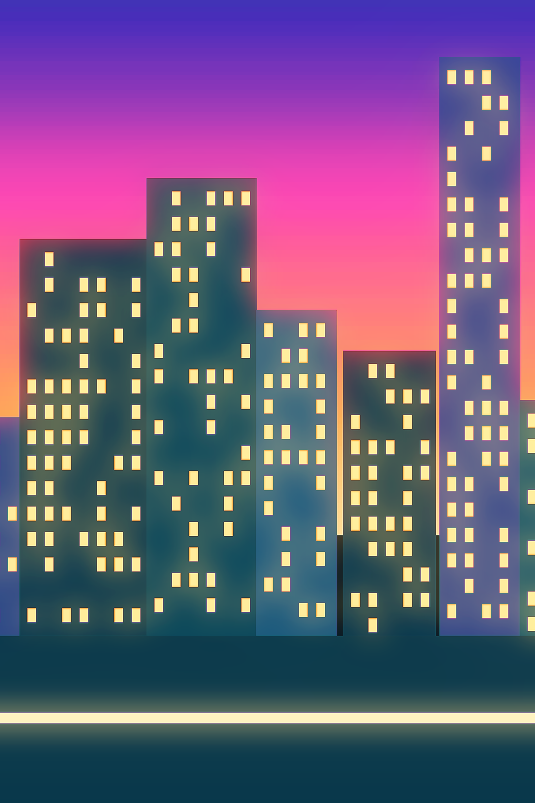
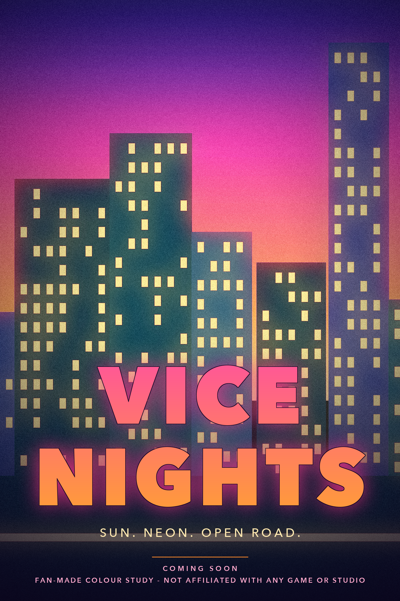
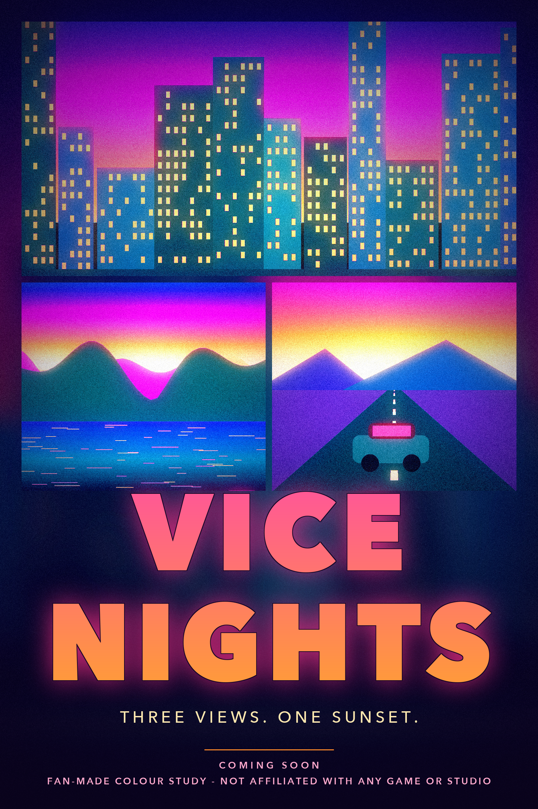

# claude-skill-gta6-poster

A free Claude skill that turns one image, several images or a folder into "GTA 6 inspired" colour-theme posters: a hot pink, orange, purple and teal sunset-neon grade with glow, grain, vignette, a big title, a tagline and a small fan-made footer.

**Disclaimer:** this is a GTA 6 inspired colour theme, a fan-made colour study. It is not affiliated with or endorsed by Rockstar Games or Take-Two. No official artwork, logo or font is used.

## Install
1. Download or clone this repo.
2. Copy the skill folder into your Claude skills folder:
   ```
   mkdir -p ~/.claude/skills
   cp -R gta6-poster ~/.claude/skills/
   ```
   (Project-only use: copy it to `<project>/.claude/skills/` instead.)
3. Install Pillow: `python3 -m pip install Pillow`
4. Restart Claude Code and ask: "make GTA 6 inspired posters from the images in ~/Pictures/test".

## Use without Claude
```
python3 gta6-poster/scripts/make_poster.py image.jpg -o out --title "VICE NIGHTS"
```
Modes: `single`, `collage` (1 to 6 images), `each` (one poster per image), `auto` (default).
Options: `--title` (`\n` for a line break), `--tagline`, `--footer`, `--palette sunset|neon|dusk`, `--size 1600x2400`, `--strength 0-1`, `--glow`, `--grain`, `--vignette`, `--font path.ttf`, `--no-text`, `--original`.
Optional contact sheet: `python3 gta6-poster/scripts/contact_sheet.py sheet.png out/*.png`

## Samples
The demo images are procedural drawings (made by `samples/make_inputs.py`), not photos.

| Original crop | Graded | Poster |
|---|---|---|
|  |  |  |

Exact commands: `samples/stages/COMMANDS.md`. More: `samples/collage3/`, `samples/single/`.



## Requirements
Python 3 and Pillow. Offline, no network, no credits.

## Use your own images
Only use images you own, and do not process photos of other people without their OK. Keep the "not affiliated" footer when you publish results.

## Licence
MIT, copyright One Man AI. Free skills from the One Man AI YouTube channel.
